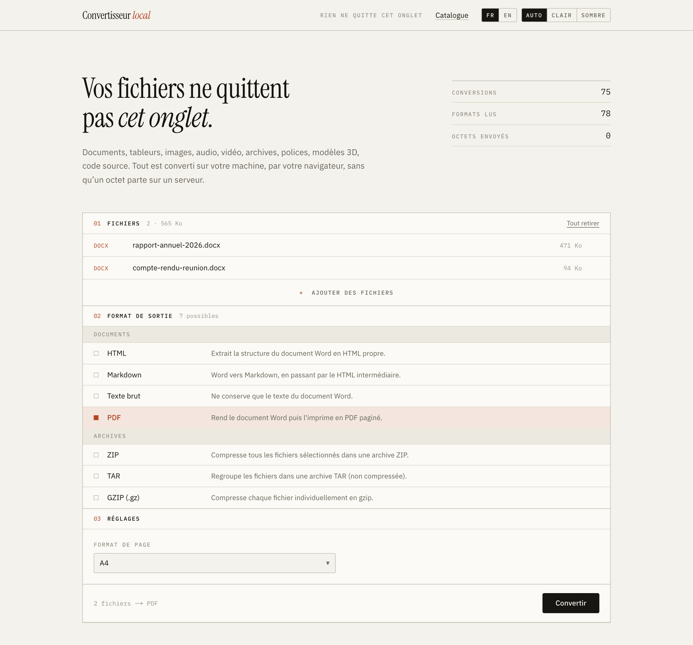

<p align="center">
  
</p>

<h1 align="center">Convertisseur local</h1>

<p align="center">
  <strong>Vos fichiers ne quittent pas cet onglet.</strong><br>
  75 conversions de documents, tableurs, images, audio, vidéo, archives,
  polices, modèles 3D et code, calculées entièrement dans le navigateur.
</p>

<p align="center">
  
  
  
  
  
</p>

<br>

<picture>
  <source media="(prefers-color-scheme: dark)" srcset="docs/screenshot-dark.png">
  
</picture>

<br>

La plupart des convertisseurs en ligne téléversent vos fichiers sur un serveur
pour les transformer. Celui-ci fait tout dans l'onglet : FFmpeg, pdf.js, Whisper
et Dart Sass tournent en WebAssembly sur votre processeur, avec l'élément
`<canvas>`, la Web Audio API et quelques bibliothèques JavaScript spécialisées.
Il n'y a rien à installer, aucun compte et aucun formulaire d'envoi.

## Points forts

- **Rien ne part.** Les fichiers sont lus en mémoire, transformés sur place,
  puis oubliés à la fermeture de l'onglet. Pas de quota, pas de filigrane.
- **75 conversions, 78 formats lus**, rangés en neuf familles.
- **Léger au chargement.** Les moteurs lourds (FFmpeg, pdf.js, SheetJS,
  Whisper, three.js, Dart Sass, TypeScript) ne sont chargés qu'à la première
  conversion qui en a besoin. La page d'accueil pèse environ 130 ko de
  JavaScript.
- **Servi depuis son propre domaine.** Les binaires WebAssembly sont copiés
  dans `public/` au build, sans CDN. Seuls les modèles Whisper viennent de
  Hugging Face.
- **Français et anglais, clair et sombre.** Deux sélecteurs dans l'en-tête,
  des choix mémorisés et aucun flash au chargement.
- **À sa place sur un écran d'accueil**, avec sa propre icône sur iOS comme
  sur Android.
- **Hors des moteurs de recherche** : chaque réponse est marquée `noindex`.

## Démarrer

Il faut Node.js 20 ou plus récent.

```bash
npm install
npm run dev
```

L'application tourne alors sur <http://localhost:3000>.

| Commande        | Rôle                                                                                |
| --------------- | ----------------------------------------------------------------------------------- |
| `npm run dev`   | serveur de développement                                                            |
| `npm run build` | build de production                                                                 |
| `npm start`     | sert le build de production                                                         |
| `npm run icons` | régénère `favicon.ico` et les icônes d'écran d'accueil à partir de `app/icon.svg`   |

`npm run dev` et `npm run build` lancent d'abord `scripts/prepare-assets.mjs`,
qui copie dans `public/` les binaires WebAssembly chargés à la demande
(ffmpeg-core, le worker pdf.js, les bindings wawoff2). Ces fichiers ne sont pas
versionnés : ils sont recopiés depuis `node_modules` à chaque fois.

## Conversions

| Famille                 | Depuis                                       | Vers                                                   |
| ----------------------- | -------------------------------------------- | ------------------------------------------------------ |
| **Documents**           | DOCX                                         | HTML · Markdown · texte brut · PDF                     |
|                         | Markdown                                     | HTML · PDF · DOCX · texte brut                         |
|                         | HTML                                         | PDF · DOCX · Markdown · texte brut · image PNG ou JPG  |
|                         | PDF                                          | une image par page · texte brut                        |
|                         | RTF                                          | HTML · texte brut · Markdown                           |
|                         | TXT, LOG                                     | PDF                                                    |
| **Tableurs et données** | XLSX, XLS, XLSM, ODS                         | CSV · JSON · HTML · XML                                |
|                         | CSV, TSV                                     | JSON · XLSX · XML · HTML                               |
|                         | JSON                                         | CSV · XLSX · XML · HTML                                |
|                         | XML, RSS, Atom                               | JSON · CSV · XLSX                                      |
| **Images**              | JPG, PNG, WebP, AVIF, BMP, GIF, ICO, TIFF, HEIC, SVG | PNG · JPG · WebP, avec échelle, qualité et fond |
|                         | GIF animé                                    | séquence d'images · sprite sheet                       |
| **Audio**               | tout fichier audio ou vidéo                  | MP3 · WAV · OGG (Vorbis) · AAC · FLAC                  |
|                         | parole, dans un audio ou une vidéo           | texte · sous-titres SRT ou VTT, avec Whisper           |
| **Vidéo**               | MP4, WebM, MKV, AVI, MOV…                    | MP4 · WebM · MKV · AVI · MOV · GIF animé               |
|                         | vidéo                                        | séquence d'images · mosaïque de vignettes              |
|                         | suite d'images                               | vidéo MP4 ou WebM · GIF animé                          |
| **Archives**            | n'importe quels fichiers                     | ZIP · TAR ou TAR.GZ · GZ                               |
|                         | ZIP, TAR, TAR.GZ, TGZ, GZ                    | fichiers extraits                                      |
| **Polices**             | TTF, OTF                                     | WOFF · WOFF2                                           |
|                         | WOFF                                         | TTF · WOFF2                                            |
|                         | WOFF2                                        | TTF                                                    |
| **Modèles 3D**          | OBJ, STL                                     | GLB · glTF                                             |
|                         | glTF                                         | GLB                                                    |
| **Code source**         | SCSS, Sass, Less                             | CSS                                                    |
|                         | TypeScript, TSX, JSX                         | JavaScript                                             |

## Comment c'est construit

```
app/                 page unique (App Router), styles, icônes et manifeste
components/          interface : dépôt de fichiers, formats, réglages, résultats
lib/types.ts         le contrat Converter
lib/registry.ts      catalogue et choix des conversions applicables
lib/converters/      une implémentation par famille de formats
lib/ffmpeg.ts        chargement paresseux de ffmpeg-core et exécution d'une commande
lib/i18n.ts          langues, type Localized et LocalizedError
scripts/             binaires Wasm avant le build, génération des icônes
```

### Ajouter une conversion

Une conversion est un simple objet `Converter` : ses formats d'entrée, son
format de sortie, une description et une fonction `run` qui renvoie les
fichiers produits.

```ts
export const minifyJson: Converter = {
  id: "json→min.json",
  from: ["json"],
  to: { fr: "JSON minifié", en: "Minified JSON" },
  category: "data",
  description: {
    fr: "Retire les espaces et les retours à la ligne.",
    en: "Strips whitespace and line breaks.",
  },
  async run(files, ctx) {
    const out: OutFile[] = [];
    for (const [i, file] of files.entries()) {
      ctx.onProgress(i / files.length, file.name);
      const data = JSON.parse(await file.text());
      out.push({
        name: `${baseOf(file.name)}.min.json`,
        blob: textBlob(JSON.stringify(data), "application/json"),
      });
    }
    return out;
  },
};
```

Il suffit ensuite de l'ajouter au tableau de sa famille, ici `dataConverters`
dans `lib/converters/data.ts`. La liste des formats, le catalogue et les
compteurs de la page suivent tout seuls. Un convertisseur peut aussi déclarer
des réglages (`options` : liste, nombre, curseur ou interrupteur), traiter
tous les fichiers d'un coup (`batch`) ou signaler qu'il télécharge un moteur
WebAssembly au premier usage (`heavy`).

### Langues

Tout texte affiché est un `Localized` : soit une chaîne identique dans les deux
langues (`"PNG"`), soit un objet `{ fr, en }`. Les convertisseurs ne
connaissent pas la langue choisie. Ils lèvent des `LocalizedError` et
signalent leur progression avec des `Localized`, que l'interface traduit à
l'affichage. Un message d'erreur change donc de langue si l'on bascule après
l'échec.

Le choix est mémorisé dans `localStorage` (clé `lang`), et le serveur rend
toujours la page en français, pour qu'elle reste statique. Quand l'anglais est
mémorisé, un script en tête de document masque la page jusqu'à ce que React
l'ait re-rendue : le français ne s'affiche jamais, même une fraction de
seconde.

### Interface

Papier chaud, encre noire, un seul accent vermillon, des filets d'un pixel et
aucun dégradé. Les couleurs tiennent dans dix variables CSS déclarées dans
`app/globals.css` et redéfinies en bloc pour le mode sombre, un charbon chaud
plutôt que bleuté. Les titres sont en Instrument Serif, l'interface en IBM Plex
Sans, les codes de format et les libellés en IBM Plex Mono. Les trois polices
sont auto-hébergées par `next/font`.

Le thème suit le système en `Auto`, ou se force en `Clair` ou `Sombre`. Comme
pour la langue, un script en tête de document applique le choix avant le
premier rendu, pour qu'aucune image ne s'affiche dans le mauvais thème.

### Icônes

Le logo `app/icon.svg` sert de favicon. Tout ce qui ne lit pas le SVG passe
par des rendus bitmap de ce logo :

- `app/favicon.ico`, pour les anciens Safari, les aperçus de liens et le
  tableau de bord Vercel ;
- `app/apple-icon.png`, pour l'écran d'accueil iOS ;
- `public/icons/`, pour Android via le manifeste `app/manifest.ts`.

Après une modification du logo, `npm run icons` régénère le tout.

## Déploiement

Le projet est un Next.js standard, prêt pour Vercel : il suffit d'importer le
dépôt, sans aucune variable d'environnement.

`next.config.mjs` ajoute deux en-têtes, `Cross-Origin-Opener-Policy:
same-origin` et `Cross-Origin-Embedder-Policy: credentialless`. Ils activent
`SharedArrayBuffer` tout en laissant les CDN publics accessibles.

### Confidentialité et indexation

L'outil n'est pas destiné à apparaître dans les moteurs de recherche :

- chaque réponse porte l'en-tête `X-Robots-Tag: noindex, nofollow, noarchive`,
  binaires WebAssembly compris ;
- la page déclare la même règle dans une balise `<meta name="robots">`.

Il n'y a volontairement pas de `robots.txt` qui interdirait l'exploration. Un
robot qui ne peut pas lire la page ne voit pas le `noindex`, et Google peut
alors indexer l'adresse seule à partir d'un lien trouvé ailleurs.

Le `noindex` empêche d'apparaître dans les résultats, pas d'ouvrir la page :
toute personne qui a le lien peut s'en servir. Pour un accès vraiment
restreint, il faut activer la protection par mot de passe de Vercel.

## Limites connues

- **PDF vers Word éditable** n'est pas proposé : un PDF décrit un dessin, pas
  une structure de document. `PDF → images` et `PDF → texte` couvrent les
  usages réalistes.
- **Pas d'OCR.** `PDF → texte` échoue explicitement sur un PDF scanné, qui n'a
  aucune couche texte.
- **FFmpeg** est la version mono-thread, d'environ 32 Mo, téléchargée une
  seule fois par session.
- **Whisper** télécharge son modèle au premier usage, de 50 à 250 Mo selon la
  taille choisie, et utilise WebGPU quand il est disponible.
- **Opus** n'est pas proposé en sortie : l'encodeur libopus de ffmpeg-core
  plante en WebAssembly. OGG (Vorbis), AAC, MP3, WAV et FLAC le remplacent.
- **La mémoire de l'onglet** est la vraie limite : une vidéo de plusieurs
  gigaoctets la saturera bien avant le disque.

## Licence

Distribué sous licence [MIT](LICENSE).
